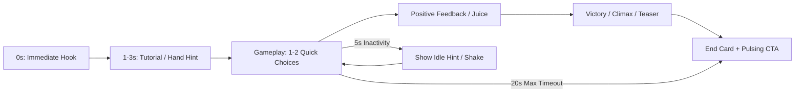

# Unity Luna Playable Ads Expert Guide & Runbook

This skill provides comprehensive instructions, constraints, and optimization patterns for building high-performing Playable Ads using **Unity** and **Luna Playworks (UPP)**.

---

## 1. Quick Checklist for Every Playable Ad

Before writing or modifying any feature, verify:
- [ ] **Target Size Budget**: Total package size < 2MB – 3MB (Ad network requirement: AppLovin, Unity Ads, IronSource, Mintegral, TikTok, Google, Meta).
- [ ] **Luna API Compatibility**: No unsupported C# reflection, heavy LINQ, file I/O (`System.IO`), or thread operations.
- [ ] **Dual Orientation**: Dynamic handling for both Portrait (9:16) and Landscape (16:9).
- [ ] **Audio Policy**: Web Audio requires first-tap unlock. Do not play unmuted audio before user interaction.
- [ ] **Call to Action (CTA)**: Proper implementation of `Luna.Unity.Playable.InstallFullGame()` and `Luna.Unity.LifeCycle.GameEnded()`.
- [ ] **Engaging Loop**: Hook within first 0–3s, idle hint/timer (5–7s), fail-safe progression to CTA.
- [ ] **Luna Playground Fields**: Key creative variables exposed via `[LunaPlaygroundField]` for marketing iterations.

---

## 2. Core Luna API & C# Integration

### Essential Namespaces and Methods
```csharp
#if UNITY_EDITOR || LUNA
using Luna.Unity;
#endif
using UnityEngine;

public class PlayableAdManager : MonoBehaviour
{
    // Expose tunable variables to Luna Playground
    [LunaPlaygroundField("Ad Settings", "Duration Before Auto CTA", 15f)]
    [SerializeField] private float autoCtaTimeout = 15f;

    [LunaPlaygroundField("Ad Settings", "Target Store URL", "")]
    [SerializeField] private string storeUrl = "";

    public void OnPlayerWinOrLose(bool isWin)
    {
        // 1. Signal end of gameplay lifecycle
        LifeCycle.GameEnded();

        // 2. Show CTA End Card UI
        ShowEndCard(isWin);
    }

    public void OnCtaClicked()
    {
        // Direct click to app store
        Playable.InstallFullGame(storeUrl);
    }
}
```

Detailed C# rules, bridge restrictions, and workarounds:
👉 See [code_conventions_and_api.md](./references/code_conventions_and_api.md)

---

## 3. Size Optimization Rules (Target < 2MB - 3MB)

Ad network acceptance relies strictly on build size:

1. **Textures & Sprites**:
   - Max texture resolution: 256x256 or 512x512. UI icons 64x64 or 128x128.
   - Use Sprite Atlasing to minimize WebGL draw calls and reduce overhead.
   - Format: Crunch compression or Luna WebP in build settings.
2. **Audio**:
   - Mono, 22.05 kHz or 32 kHz, compressed quality (32–64 kbps MP3/AAC).
   - Clip length: Max 2–3s SFX, 10–15s looped BGM (or no BGM if size is tight).
3. **Typography & Fonts**:
   - Never include full TTF/OTF with unicode ranges (CJK/emoji).
   - Use stripped TextMeshPro font assets (ASCII only 32–126) or pre-rendered sprite text.
4. **Meshes & 3D**:
   - Keep polygon count < 10,000 tris across the entire scene.
   - Strip unused channels (tangents, vertex colors, UV2).
5. **Shaders & Rendering**:
   - Use `Luna/Unlit`, `Mobile/Particles`, or lightweight unlit shaders. Avoid Standard PBR and multi-pass shaders.

Detailed optimization parameters:
👉 See [size_optimization.md](./references/size_optimization.md)

---

## 4. Playable Ad Lifecycle & UX Best Practices



- **First 3 Seconds**: Instant hook with visual hint (animated hand or pulsing button). Zero loading screens.
- **Micro-interactions (Juice)**: Scale punch on tap, confetti/particles, instant sound.
- **Fail-safe Auto-progress**: If the player doesn't interact within 5–7 seconds, replay the hint or trigger auto-step.
- **Responsive Layout**: Adjust camera FOV / Orthographic size or UI Canvas matching between portrait and landscape.

Full UX patterns and orientation script:
👉 See [playable_ad_lifecycle.md](./references/playable_ad_lifecycle.md)

---

## 5. Debugging & Verification

When compiling or testing:
1. **Luna Develop / Build**:
   - Check the Luna Build window (`Window > Luna > Develop`).
   - Monitor `LunaTemp` size breakdown to catch sudden size spikes.
2. **Browser DevTools Console**:
   - Look for `Bridge Error`, missing native Unity methods, or WebGL shader compilation issues.
3. **Network Emulation**:
   - Test under Fast 3G throttling to verify quick initial load (< 2 seconds).

Common errors and solutions:
👉 See [troubleshooting_and_debugging.md](./references/troubleshooting_and_debugging.md)
